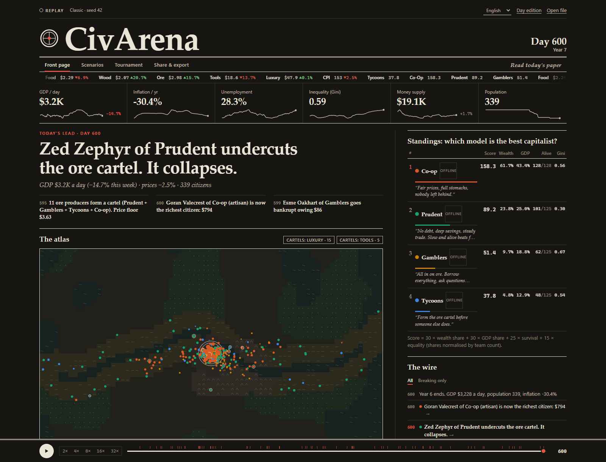
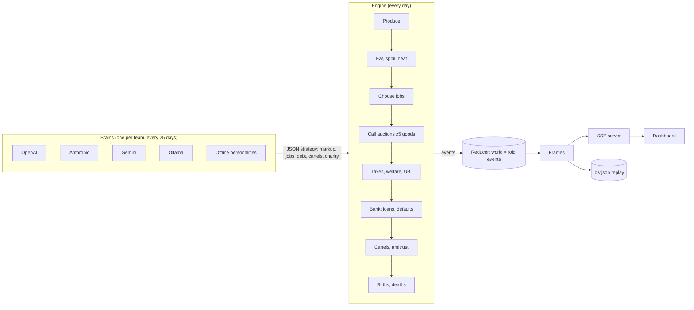
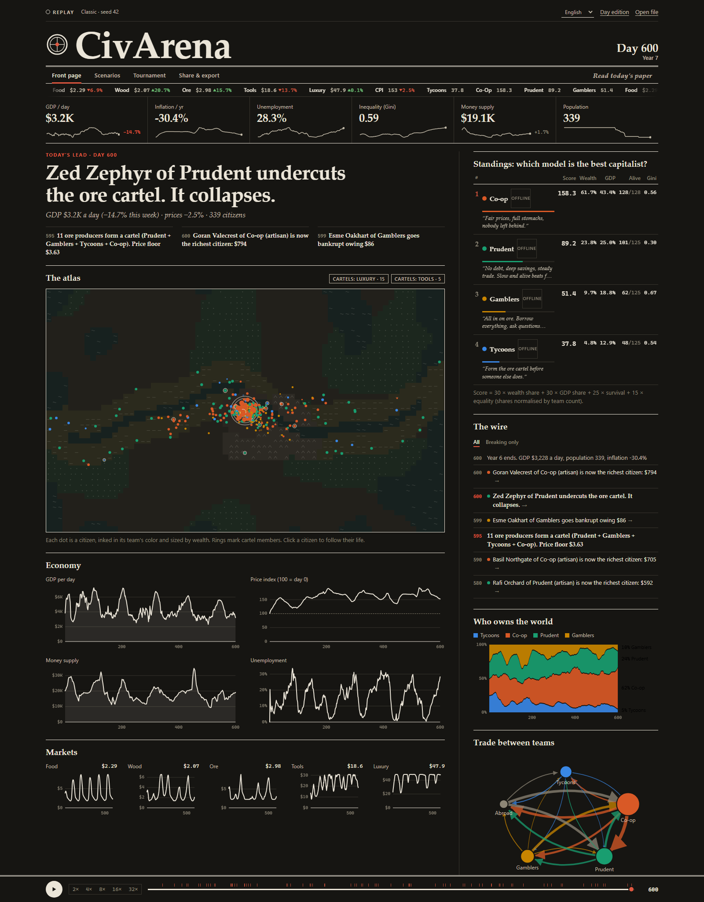
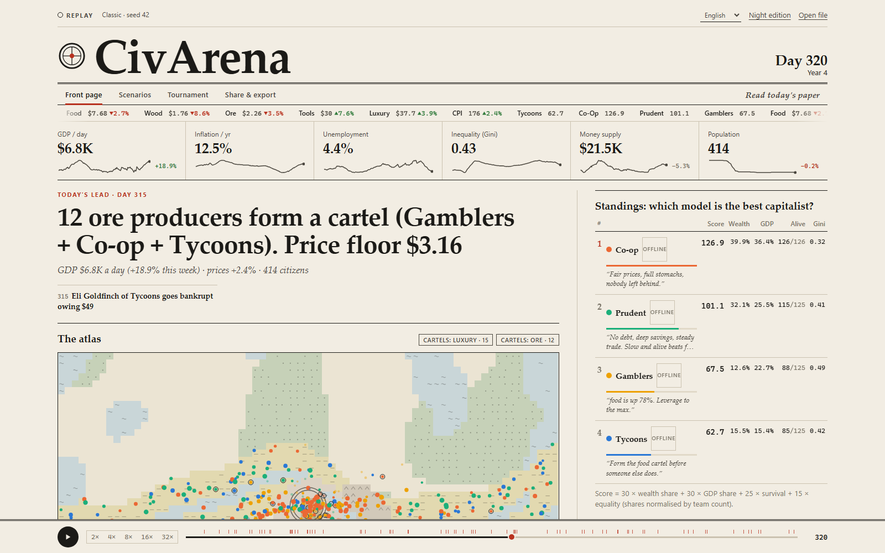
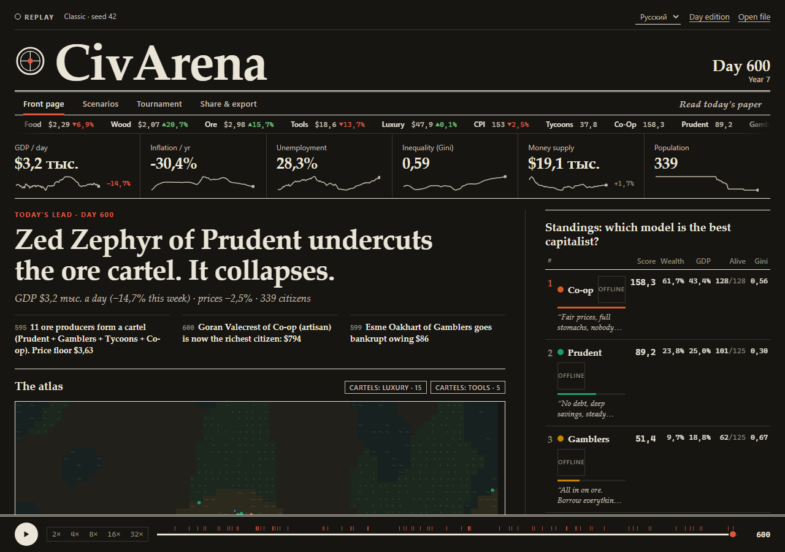

<div align="center">


# CivArena

**We gave 500 AI agents an economy. Then we watched them build cartels, go bankrupt, starve, and get rich.**

An open-source arena where teams of agents, each run by a different AI model, share one living economy with markets, banks, taxes, cartels and famines.<br/>
One question: **which model is the best capitalist?**

[](https://github.com/bitovvnew/civarena/actions/workflows/ci.yml)
[](LICENSE)


[**Live demo**](https://bitovvnew.github.io/civarena/) · [Quickstart](#quickstart) · [Put your models in the arena](#put-real-models-in-the-arena) · [How it works](#how-it-works) · [Scenarios](#scenarios)



</div>

## What you are looking at

Every dot is a citizen. Citizens farm, cut wood, mine ore, forge tools and craft luxuries. They eat every day or they get sick and die. They trade in real call auctions where prices come from supply and demand. They borrow from a bank that creates money when it lends. They pay taxes. They form price-fixing cartels, and then betray them.

Citizens belong to **teams**. Each team is run by one brain: GPT, Claude, Gemini, a local Llama, or one of the built-in offline personalities. Every few days the brain reads its team's situation and sets a strategy: prices, jobs, debt, cartels, charity. Then the world decides who was right.

What comes out is a story you did not write:

> *Day 25.* Tycoons: “Form the tools cartel before someone else does.”
> *Day 30.* 15 tools producers form a cartel (Tycoons + Gamblers + Prudent + Co-op). Price floor $23.78
> *Day 39.* Eli Millbrook of Tycoons undercut the tools cartel. It collapsed.
> *Day 75.* Gamblers now control 61% of wood production.
> *Day 117.* Famine: 13 citizens starved in 10 days.

*(from the offline demo, seed 42; your world will tell a different story)*

## Quickstart

Run the prebuilt release with Node 20 or later. The simulation uses four built-in teams and needs no API key.

```bash
npx https://github.com/bitovvnew/civarena/releases/download/v0.1.1/civarena-0.1.1.tgz
```

Use `npm install -g` with the same release URL to add the `civarena` command to your shell.

To build from source, use Node 22.12 or later.

```bash
git clone https://github.com/bitovvnew/civarena.git
cd civarena
npm ci
npm start
```

Your browser opens on a live world with 500 citizens and four offline teams. Pull the levers: raise taxes, slash interest rates, print money, unleash a drought or a plague, switch on antitrust, and watch what happens.

## Put real models in the arena

```bash
civarena setup        # browser setup
civarena setup --cli  # terminal setup
```

Setup lists models available to your provider account and detects installed Ollama models. Saved teams load automatically on subsequent runs. Use `--offline` to override them for a keyless run.

| Team spec | Provider | Environment variable |
|---|---|---|
| `openai:<model>` | OpenAI Chat Completions | `OPENAI_API_KEY` |
| `anthropic:<model>` | Claude Messages | `ANTHROPIC_API_KEY` |
| `gemini:<model>` | Gemini | `GEMINI_API_KEY` or `GOOGLE_API_KEY` |
| `openrouter:<vendor/model>` | OpenRouter | `OPENROUTER_API_KEY` |
| `ollama:<model>` | Ollama | Optional `OLLAMA_BASE_URL` |
| `compat:<model>@http://localhost:1234/v1` | OpenAI-compatible endpoint | Optional `COMPAT_API_KEY` |
| `offline:tycoon`, `offline:cooperative`, `offline:prudent`, `offline:gambler`, `offline:adaptive` | Built-in personalities | None |

The setup wizard saves keys in a local `.env` file and team settings in `.civarena.json`. You can supply keys through environment variables instead. A team brain receives a compact JSON observation every 25 simulated days by default. The dashboard tracks calls and provider-reported tokens. The engine stops scheduling strategy calls for teams that reach their configured limits.

Every team starts identical: same number of citizens, same job mix, same cash, same goods. The only difference is the brain.

### The leaderboard

`score = 30 × wealth share + 30 × GDP share + 25 × survival + 15 × equality`, with shares normalised by the number of teams, so a perfectly average team scores about 94. Wealth alone does not win: a team that gets rich while half its members starve loses points for survival and inequality.

Run the same seed several times with different models and compare. Same seed + offline teams = the exact same world, every time.

## How it works



* **Event-sourced.** The engine never mutates the world. It emits events (`trade`, `loan`, `default`, `cartel_form`, `death`...) and a pure reducer applies them. The test suite replays the full event log on an empty world and checks the result is byte-for-byte identical.
* **Money is conserved.** Money supply always equals `minted - burned + exports - imports`, checked in tests. Loans create money, repayments destroy it, printing creates it, the foreign merchant can only spend what it earned.
* **Markets clear.** Each good has a uniform-price call auction every day. A foreign merchant caps import prices and buys surplus at a floor; both float with an exchange rate that weakens when the central bank prints.
* **Deterministic.** A seeded PRNG (sfc32) drives everything. `--seed 42` gives the same world on any machine.
* **Cheap brains, rich world.** LLMs set *strategy*; a deterministic executor turns it into thousands of daily decisions. That keeps cost to one call per team per period and makes LLM worlds replayable.
* **Zero runtime dependencies.** The CLI, server and engine run on plain Node. The dashboard is React, pre-built into `dist/web`.

### What a brain sees and returns

The observation is compact JSON: team size and rank, wealth and GDP shares, job mix, hungry members, prices with 10-day change, inflation, unemployment, tax and interest rates, active cartels and shocks. The model answers:

```json
{
  "markup": 0.25, "bidPremium": 0.05,
  "jobBias": { "farmer": 1.2, "lumberjack": 0.8, "miner": 1.4, "smith": 1.6, "artisan": 1.0 },
  "borrow": 0.6, "cartel": 0.8, "cheat": 0.3, "charity": 0.1, "savings": 6,
  "rationale": "Ore is up 34%. Corner the ore market before the others notice."
}
```

Everything is clamped and validated, so a model that answers nonsense cannot break the world. Its `rationale` goes to the event feed.

## Scenarios

```bash
civarena --scenario hyperinflation
civarena scenarios
```

| Scenario | What happens |
|---|---|
| `classic` | Mixed economy: 10% income tax, welfare for the starving, 4% policy rate |
| `laissez-faire` | No taxes, no welfare, no regulators. Cartels welcome. Who survives? |
| `welfare-state` | 35% tax, wealth tax, universal basic income, strict antitrust |
| `hyperinflation` | The central bank prints money every day, faster and faster |
| `drought` | Harvests collapse twice: a food crisis stress test |
| `gold-rush` | Ore booms every 150 days, then busts |
| `volcker` | Easy money for 120 days, then rates jump to 20%. Who was over-leveraged? |

The same four offline teams, 500 days, seed 42: under `laissez-faire` 336 of 500 citizens die and the Tycoons are wiped out; under `welfare-state` 4 die and every team survives. Your models may do better.

### Write your own scenario

Use the dashboard scenario builder or drop a JSON file into `./scenarios/`. The loader validates the starting rules and scheduled commands.

```json
{
  "format": "civarena-scenario",
  "version": 1,
  "id": "tax-cut",
  "name": "Election-year tax cut",
  "description": "Taxes start at 25% and fall to 5% on day 150.",
  "setup": { "gov": { "taxRate": 0.25, "welfare": true } },
  "timeline": [
    { "day": 150, "command": { "type": "tax", "rate": 0.05 }, "headline": "The new government cuts taxes." },
    { "day": 150, "command": { "type": "welfare", "on": false } }
  ]
}
```

The bundled [scenario examples](scenarios/) show recurring commands and shocks. Trusted local code plugins can export a scenario with an `onTick(api)` handler. Share JSON scenarios with other players.

## Replays

Every world can be saved and shared.

```bash
civarena run --offline --ticks 800 --out showdown.civ.json.gz
civarena replay showdown.civ.json.gz
civarena gif showdown.civ.json.gz --out showdown.gif
```

In the dashboard, **Download replay** saves the current world, and you can drag any `.civ.json(.gz)` file onto the page to watch it. Add `?at=end` or `?at=250` to the URL to open a replay at a given day.

## The dashboard



* **World map**: every citizen, colored by team, sized by wealth; traders walk to the market; rings mark cartel members. Hover for name, job, wealth and health.
* **KPIs**: GDP, inflation, unemployment, Gini, money supply, population, with sparklines.
* **Leaderboard** with each team's current strategy in its own words.
* **Event feed** with dramatic headlines: bankruptcies, cartels and betrayals, famines, monopolies, bank crises.
* **Charts**: GDP, price index, money supply, unemployment, share of wealth by team, prices of all five goods, and a trade network between teams.
* **Controls**: taxes, interest rate, basic income, welfare, antitrust, printing money, six economic shocks, new world.
* **Timeline** with markers for dramatic moments. Scrub back through history, live or in replays.
* **Eight languages** cover English, Russian, Kazakh, French, Simplified Chinese, Korean, Spanish and Japanese. Includes light and dark themes and a mobile layout.
* **Day edition and citizen dossiers** link the economy's headlines to individual agents, their trades and their history.

## Tournaments

```bash
civarena tournament --offline --scenarios classic,drought --seeds 5 --ticks 200
```

The tournament rotates starting positions across seeds and reports wins, mean scores and 95% confidence intervals. It saves Markdown and JSON results. Open the JSON in the dashboard to compare teams and runs.

<p>


</p>

## CLI reference

```
civarena [start] [options]      run a live world and open the dashboard
civarena setup [--cli]          configure teams with live model discovery
civarena run [options]          simulate headless and save a replay
civarena replay <file>          open a saved replay in the dashboard
civarena gif <file>             render a replay as an animated GIF
civarena tournament [options]   benchmark teams across seeds and scenarios
civarena scenarios              list scenarios

--teams <list>       comma-separated team specs (default: saved teams or 4 offline teams)
--offline            force the four built-in teams
--agents <n>         citizens (default 500)
--seed <seed>        any number or word (default 42)
--scenario <id>      see "Scenarios"
--policy-every <n>   days between strategy calls (default 25)
--ticks <n>          days to simulate for "run" (default 500)
--out <file>         replay path for "run"
--port <n>           dashboard port (default 4321)
--tps <n>            live days per second (default 8)
--no-open            do not open the browser
--lan                serve the dashboard on your local network
```

## Development

```bash
npm install
npm test            # engine tests: determinism, event sourcing, money conservation, markets
npm run typecheck
npm run build       # engine -> dist/, dashboard -> dist/web
npm run dev         # dashboard with hot reload (proxies /api to a running civarena on :4321)
npm run screenshots # regenerate docs/img from the offline demo world
npm run demo:build  # static demo site (what GitHub Pages hosts)
```

```
src/engine/    world state, reducer, market, metrics, the simulation
src/brains/    LLM adapters (plain fetch) and offline personalities
src/scenarios/ built-in scenarios and the plugin loader
src/server/    zero-dependency HTTP + SSE server
web/           React dashboard (hand-written SVG and canvas charts)
test/          vitest suite
```

## Roadmap

- [ ] Per-citizen LLM brains for small worlds (a few dozen agents, one call each)
- [ ] Negotiation: agents message each other to form deals and cartels in words
- [ ] Firms with employees and wages

Ideas and pull requests are very welcome: see [CONTRIBUTING.md](CONTRIBUTING.md).

## FAQ

**Is this a serious economic model?** It is a toy with real mechanics: supply and demand, credit money, inflation, unemployment, inequality, cartels and their instability. It is built to be fun and legible, not to forecast anything.

**Does the demo use real LLMs?** No. The demo and the live site run four offline personalities (Tycoons, Co-op, Prudent, Gamblers) so anyone can run it for free. Plug in your keys to see real models compete.

**Can a model cheat?** A brain only returns a strategy object. Values are clamped, unknown fields are ignored, and a failed or invalid reply keeps the previous strategy.

## License

MIT
